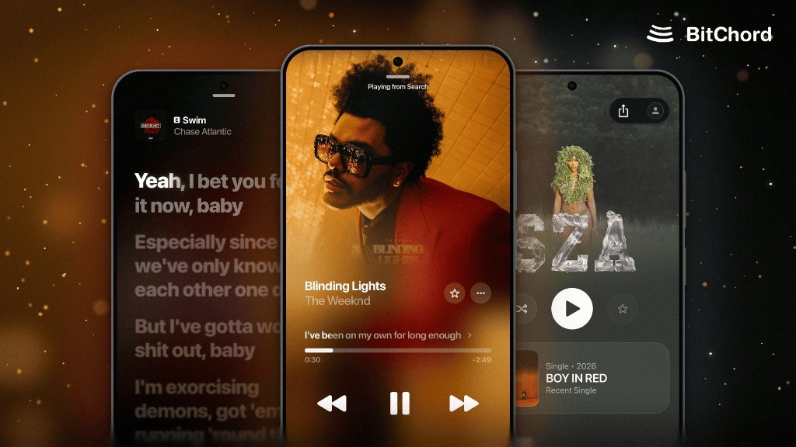

<div align="center">


# BitChord for iPhone

**An unofficial native iPhone port of [BitChord](https://github.com/kushagrasinghx/BitChord) by [Kushagra Singh](https://github.com/kushagrasinghx).**<br>
Open-source YouTube Music client · Customizable widgets · In-app updates · Automix · Hi-Res · eSign-friendly.

<br>

[](https://github.com/K007-K/BitChord/releases/latest)
[](LICENSE)
[](#download)

[](App)
[](App/BitChordWidget)
[](App/BitChord/Intents)

**[Download](#download)** · **[Features](#features)** · **[Install](#install)** · **[Build from source](#build-from-source)** · **[Contributing](#contributing)** · **[Disclaimer](#disclaimer--legal-notice)**

<br>



<br>

</div>

> [!IMPORTANT]
> This is an unofficial iPhone port of [BitChord](https://github.com/kushagrasinghx/BitChord) by [Kushagra Singh](https://github.com/kushagrasinghx), maintained by [K007-K](https://github.com/K007-K), based on the iOS port by [maanya145](https://github.com/maanya145/BitChord-iOS). It is not affiliated with, endorsed by, or connected to YouTube or Google in any way. Use it at your own discretion.

## Download

<div align="center">

<a href="https://github.com/K007-K/BitChord/releases/latest"></a>

<sub><b>iPhone &amp; iPad:</b> unsigned IPA for iOS 17 or later &nbsp;·&nbsp; Install via eSign (free) or AltStore / SideStore &nbsp;·&nbsp; In-app updater included</sub>

</div>

The IPA is attached to the [latest release](https://github.com/K007-K/BitChord/releases/latest). Once installed, go to **Settings → Updates → Check for Updates** to download future versions directly from within the app — no Mac needed after the first install.

## Features

### Listening
- **YouTube Music** search, browsing and playback, with optional Google sign-in. Accounts with several YouTube channels can switch profiles in Settings.
- **Downloads** for offline listening, with per-song progress, metadata and lyrics baked in.
- **Import** your own audio files from the Files app. Play from SMB and WebDAV network shares.
- **Library** — your YouTube Music playlists, liked songs, and history, all in one place.

### Sound
- Separate streaming quality for **Wi-Fi and mobile data**, plus a **Dolby Atmos** option.
- Optional add-on sources for lossless and Atmos streams, with YouTube Music as the fallback.
- **Equalizer**, loudness normalization, skip silence, crossfade (0–12 s) and stereo widening.
- Stats for nerds: codec, bitrate and audio pipeline on the Now Playing screen.

### Automix
- **DJ-style transitions** that match tempo, align beats and hand over between songs.
- Beat analysis via Core ML on the Neural Engine. Automix keeps a fallback without models.

### Lyrics
- Synced lyrics with line and word highlighting from multiple providers: LRCLIB, Musixmatch, Genius, KuGou, PaxSenix, BetterLyrics, and more.
- Translate lyrics, adjust timing offset, share lines as an image card.

### Widgets — New in v1.0.6
- **Home Screen widgets** in four sizes, each with 3 styles:
  - **Small (2×2):** Album art + compact controls
  - **Medium 4×2:** Full-width artwork + title, artist, controls
  - **Medium 4×1:** Pill row with track info and all controls
  - **Large 4×4:** Big cover + full 5-button transport (Like, Prev, Play, Next, Shuffle)
- **Lock Screen widgets:** Circular album art · Rectangular bar with controls
- **3 styles per widget:** Artwork · Glass · Minimal — pick per-widget in Edit Widget

### Made for iOS
- **SwiftUI** throughout, with a full Now Playing screen, CarPlay interface and landscape layout.
- **Lock Screen and Control Center** media controls.
- **Share extension** that opens YouTube / YouTube Music links directly in BitChord.
- **App Intents** for playback automation and Siri.
- **In-app updater:** Settings → Updates → Check for Updates — downloads and opens in eSign.

### Together
- **Listen Together:** host a listening party and invite others with a code, link or QR code.
- **Replay:** listening statistics by period with a shareable poster.
- **Discord Rich Presence** with in-app sign-in.
- Scrobbling to **Last.fm** and **ListenBrainz**.

## Install

### eSign (easiest — free)

1. Download the IPA from the [latest release](https://github.com/K007-K/BitChord/releases/latest).
2. Import into [eSign](https://esign.yyyue.xyz/) and install.
3. Open BitChord → **Settings → Updates → Check for Updates** for future updates — no Mac required.

> [!NOTE]
> eSign strips the App Group entitlement. Widgets will show a styled BitChord placeholder instead of live now-playing data. Everything else works fully.

### AltStore / SideStore

1. Download the IPA from the [latest release](https://github.com/K007-K/BitChord/releases/latest).
2. Add it via AltStore or SideStore.
3. Widgets show **live now-playing data** (App Group entitlement is preserved).

## Build from Source

### Requirements

- macOS with **Xcode 16** or later.
- An Apple Developer account (free tier works for local builds and device installs).

### Steps

```sh
git clone https://github.com/K007-K/BitChord.git
cd BitChord
open BitChord.xcworkspace
```

Select the `BitChord` scheme, choose your device or simulator, and build (⌘B). Sign in with your Apple account in Xcode if prompted — a free account is enough.

> [!NOTE]
> The project uses a local ONNX Runtime stub so the build works without the upstream Swift package. No extra steps needed.

<details>
<summary><b>Build unsigned IPA (for eSign)</b></summary>

<br>

```sh
xcodebuild \
  -workspace BitChord.xcworkspace \
  -scheme BitChord \
  -configuration Release \
  -destination "generic/platform=iOS" \
  CODE_SIGNING_ALLOWED=NO \
  CODE_SIGNING_REQUIRED=NO \
  build
```

Then wrap the `.app` in a `Payload/` folder and zip it as `.ipa`.

</details>

<details>
<summary><b>Optional Listen Together server</b></summary>

<br>

The app does not ship with a hosted Listen Together service. Enter a compatible server URL in **Settings → Listen Together**, or leave it blank to use the default community server.

</details>

<details>
<summary><b>Optional Automix models</b></summary>

<br>

Automix works without downloaded models using its built-in tempo and DSP fallbacks. When a Core ML beat model is present the Neural Engine accelerates the analysis pass. No model is bundled with the app.

</details>

## Contributing

Bug reports, ideas and pull requests are welcome in [Issues](https://github.com/K007-K/BitChord/issues) and [Pull requests](https://github.com/K007-K/BitChord/pulls). Please include your device, iOS version, and BitChord version (shown in **Settings → Updates**).

<div align="center">

**Contributors to this build**

<a href="https://github.com/K007-K/BitChord/graphs/contributors"></a>

**And the port this build is based on**

<a href="https://github.com/maanya145/BitChord-iOS/graphs/contributors"></a>

</div>

## Disclaimer & Legal Notice

BitChord is an independent, unofficial third-party music player and client. It is not affiliated with or endorsed by Google LLC, YouTube Music, or the providers of any configured sources.

- **No Media Hosting:** BitChord does not operate a hosted music catalog. It plays local libraries and accesses configured sources and third-party services; downloads are stored on the listener's device.
- **Fair Use & API Usage:** BitChord is created for personal, research, educational and fair-use purposes. It does not grant rights to music or other content. You are responsible for ensuring your use complies with applicable copyright law and the terms of the services and APIs you choose to access, including YouTube and YouTube Music.
- **No warranty and limitation of liability:** The software is provided without warranty and liability is limited as stated in Sections 15 and 16 of [`LICENSE`](LICENSE).
- **Copyleft:** GPLv3 allows redistribution, including for a fee, subject to its terms. Distributors of GPLv3-covered binaries must meet the corresponding-source and notice requirements.

## Credits and Licenses

Based on the iOS port by [maanya145](https://github.com/maanya145/BitChord-iOS), which is itself derived from [BitChord](https://github.com/kushagrasinghx/BitChord), Copyright © Kushagra Singh and BitChord contributors, licensed under GPLv3. This build and additions Copyright © 2026 K007-K, also under GPLv3.

YouTube stream extraction uses [InnerTubeX](https://github.com/MetrolistGroup/innertubex). Some analyzer code was ported from [Orchard](https://github.com/SFG5453/Orchard) by SFG545 through BitChord's Android implementation; those files retain their AGPLv3 terms. The upstream README credits [binimum/am-lyrics](https://github.com/binimum/am-lyrics) for the Apple-like lyrics animation; that credit is preserved here.

Third-party libraries: [AMSMB2](https://github.com/amosavian/AMSMB2) (LGPL-2.1) for SMB shares · [ONNX Runtime](https://github.com/microsoft/onnxruntime-swift-package-manager) (MIT) for Automix models · Beat This! (CPJKU) and Open-Unmix (Inria/SigSep) ML models. See [THIRD-PARTY-NOTICES.md](THIRD-PARTY-NOTICES.md) for the full list.

## License

The project is licensed under the **GNU General Public License v3.0 (GPLv3)**; see [`LICENSE`](LICENSE). Some files and bundled dependencies carry additional or separate terms. Read [`THIRD-PARTY-NOTICES.md`](THIRD-PARTY-NOTICES.md) and individual source headers before redistributing or modifying those components.

Binary releases: every GitHub release is built from its tagged commit, and that tag's source archive is the Corresponding Source (GPLv3 §6).
